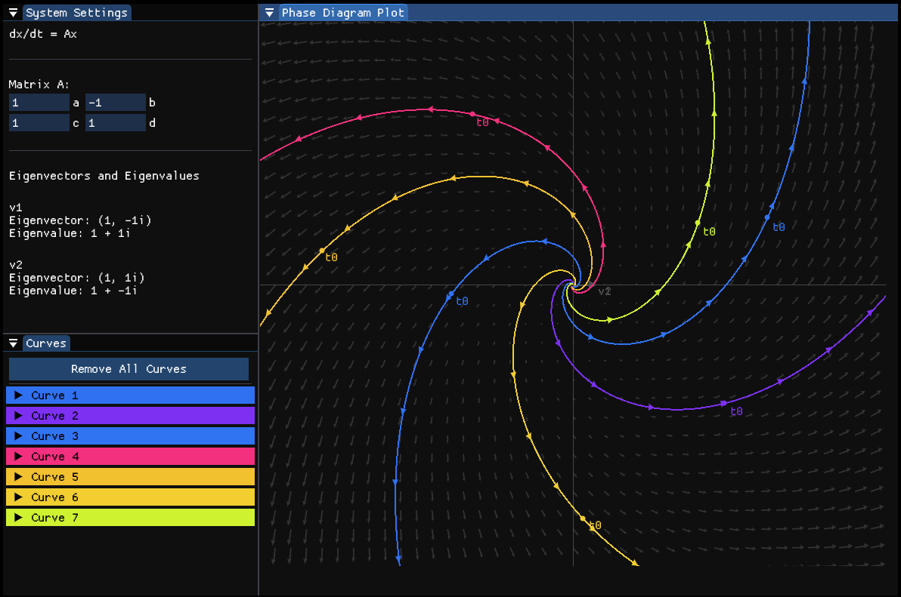
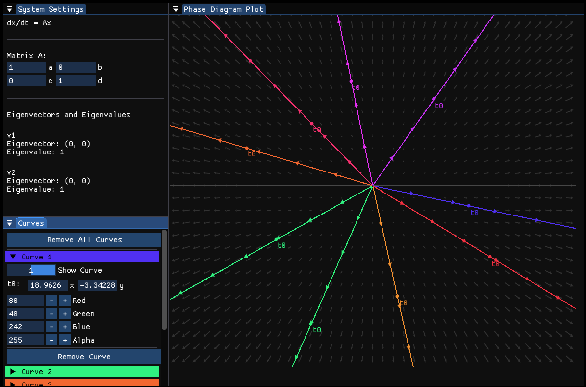
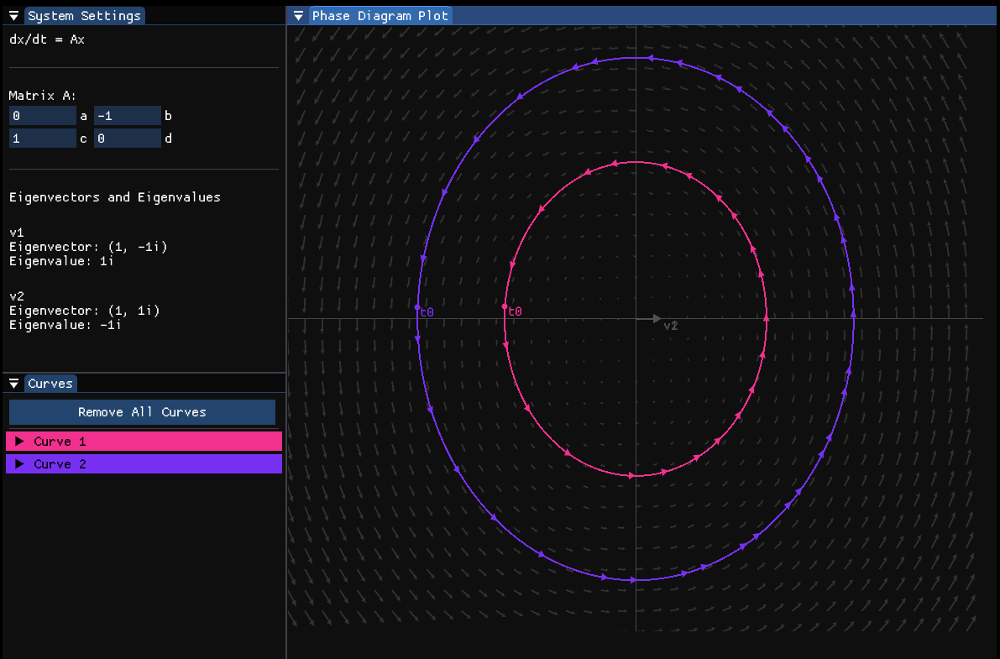
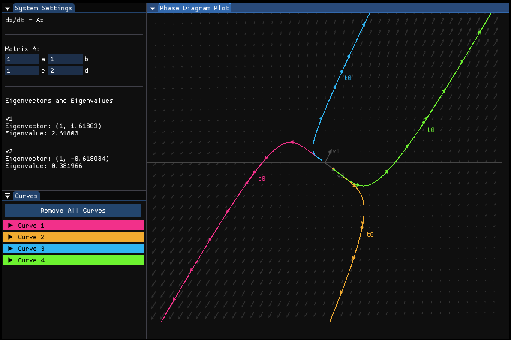
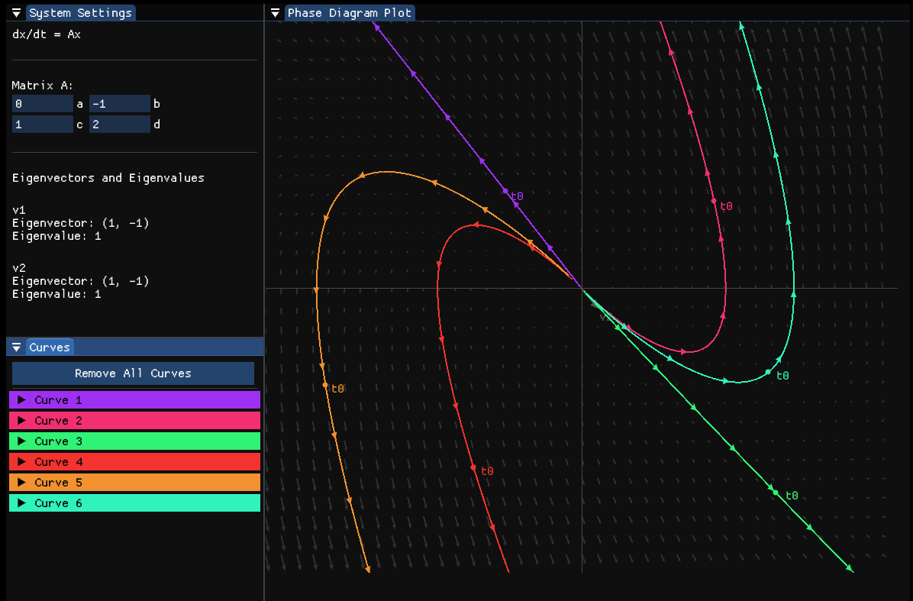
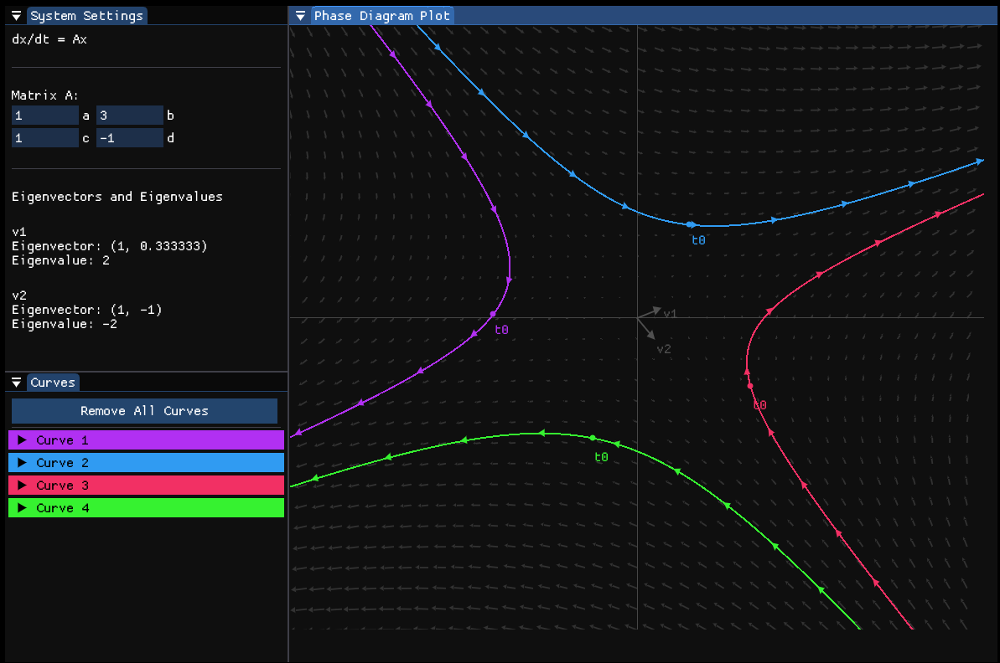
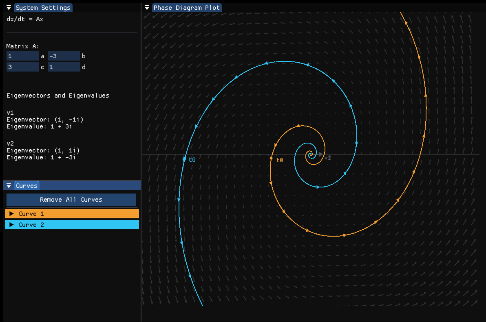

# Phase Portrait Visualiser

A linear system phase portrait plotter written in C++ using [Raylib](https://www.raylib.com/) and [ImGui](https://github.com/ocornut/imgui)

<hr>



<hr>

## Compiling

### Release Build

If you wish to compile your own version from the source code, simply run the following commands in the root directory:

```bash
premake5 gmake
mingw32-make config=release
```

or for a clean build run:

```bash
premake5 gmake
mingw32-make clean config=release
```

To then run the executable use the following command:

```bash
./bin/Release/phase-plotter.exe
```

## The Editor



<hr>

### System Settings

The **system settings panel** is where you set the system's matrix 'A' in dx/dt = Ax, this determines how each trajectory behaves over time on the phase plot.

The system settings also displays any eigenevectors (complex included) that your system's matrix has and if they are real valued they are plotted on the phase diagram at the origin as well.

### Curves

The **curves panel** is where you control each curve you have plotted on the phase diagram. Each dropdown is the same colour as its corresponding curve on the phase diagram.

In a given curve's dropdown you can:
- Control whether the curve should be visible on the plot
- Change the curve's starting point (t0), changing this value will automatically update the rest of the curve
- Set the curve's colour using the seperate red, green, blue and alpha (transparency) channels
- Remove the given curve, deleting it from the diagram

### Phase Diagram Plot

The **phase diagram plot** is where the actual curves are plotted, if you left click anywhere on the graph it will plot a new solution where the intial point (t0) is your mouse position (this can later be set using the **curves panel**).

Each solution curve shows the path of a given particle if it was placed in the vector field at t0 and its path is approximated using the [Runge-Kutta 4th Order Method (Wikipedia)](https://en.wikipedia.org/wiki/Runge%E2%80%93Kutta_methods).

The current vector field's direction is shown at given intervals along the curve, this changes based on the current  'A' showing the direction a particle would move if placed at that point on the line (i.e the direction of increasing t).

## Screenshots

<table>
    <tr>
        <th></th>
        <th></th>
    </tr>
    <tr>
        <th></th>
        <th></th>
    </tr>
    <tr>
        <th></th>
        <th></th>
    </tr>
</table>